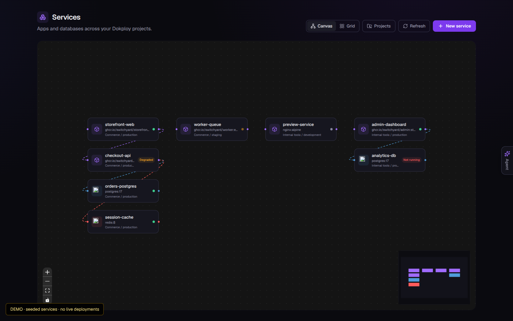
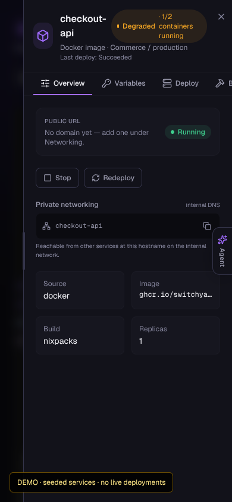
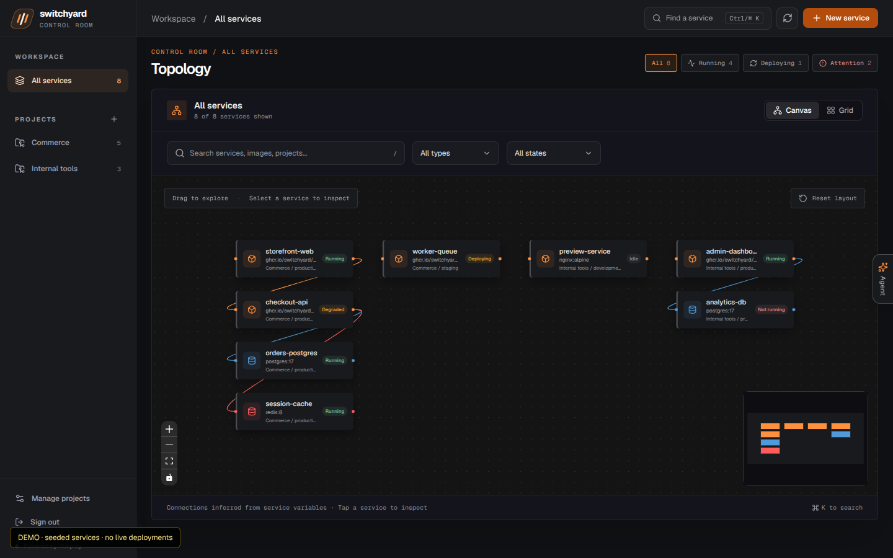
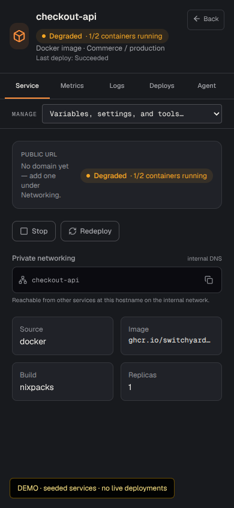

# Control room review

This folder is the visual and assessment material for the proposed Switchyard operator workspace. The source branch targets `main`; nothing here represents a live Dokploy deployment.

## Before and after

| Desktop | Mobile service view |
| --- | --- |
| [Watch the 41-second comparison](desktop-before-after.mp4) | [Watch the 18-second comparison](mobile-before-after.mp4) |
|  |  |
|  |  |

**Recording provenance:** These videos and stills were captured with seeded demo services on an earlier local implementation. That temporary checkout was cleared. The code in this PR was rebuilt from the same baseline and implements the core interactions, but the media is a design reference, not an exact recording of this commit. It does not show live logs, metrics, deployments, or a real agent run.

## What this branch changes

- Persistent project and environment navigation, mobile navigation, scoped deploy destination, service search, type filter, and fleet health filters.
- Orange operator palette, compact control room header, runtime-aware status in grid cards, and canvas layout reset with stable positions while filtering.
- Full-width service view on phones. Its primary sections are Service, Metrics, Logs, Deploys, and Agent; less frequent configuration lives under Manage.
- A likely-error text filter in live logs and service-context drafts for the built-in agent. Selecting an agent task fills the composer for review; it does not send or apply a change.
- Sealed session validation on every agent route, with a seven-day age check and a production HTTP regression script.

## Verification and limits

`npm run build`, `npm run lint`, and `npm run test:auth` passed in `dashboard/`. The auth test rejects forged, expired, and future cookies and accepts a valid sealed session. The build emitted a nonfatal Turbopack file-tracing warning from the existing agent key store.

The reconstructed commit did not receive a fresh browser visual pass because Chromium was unavailable in the recovery VM. A real Dokploy lifecycle, DNS, rollback, backup/restore, desktop installer, and multi-user authorization test were also not exercised. Review the [assessment](ASSESSMENT.md) for open security and product gaps before release.
